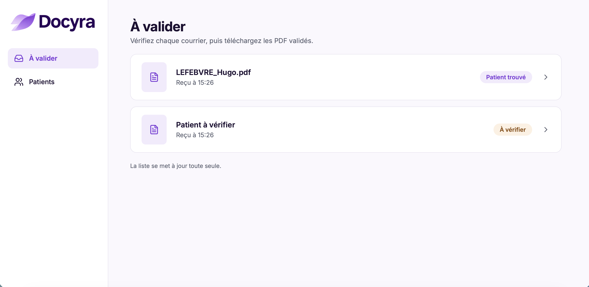

# Docyra

Outil pour secrétariat médical : on prend un courrier en photo, Docyra trouve le patient dans le texte et crée le PDF `NOM_Prénom.pdf`, prêt à classer dans le dossier du patient.

## Fonctionnalités

- Import de la liste des patients depuis un fichier CSV
- Lecture du texte du courrier (OCR avec Tesseract)
- Recherche du patient dans le texte, sans tenir compte des accents ni des majuscules
- Détection et redressement de la page sur la photo (OpenCV)
- Création du PDF avec le nom du patient (Apache PDFBox)
- File « À valider » et page de vérification du patient

| Patients | À valider |
| --- | --- |
|  |  |

## Stack

- **Back** : Java 25, Spring Boot, Spring Data JPA, PostgreSQL, Flyway, Tess4J, OpenCV, PDFBox
- **Front** : Angular, Lucide
- **Outils** : Docker Compose, JUnit, Mockito

## Lancer le projet

cp .env.example .env
docker compose up --build

- Application : http://localhost:8000
- API : http://localhost:8080