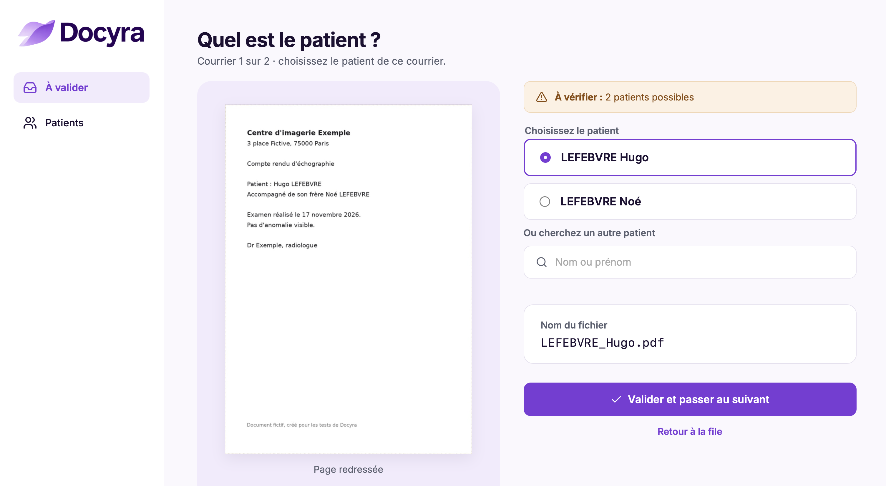
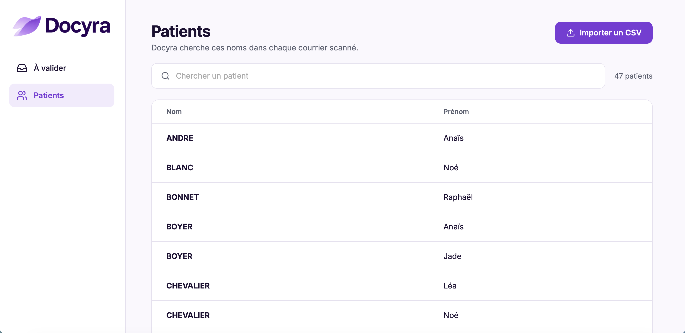
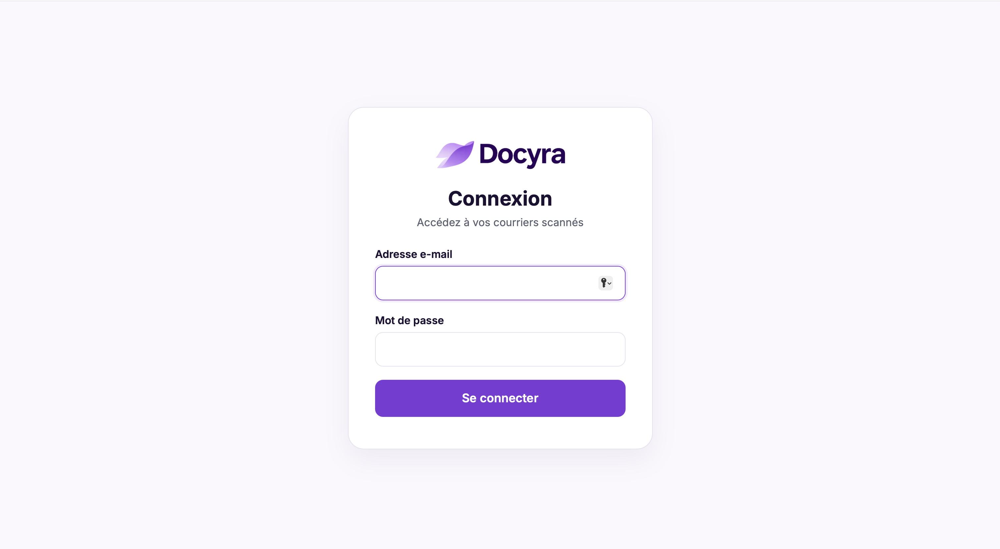
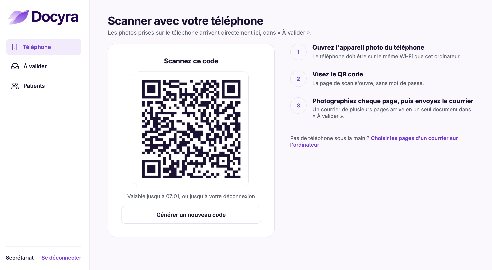
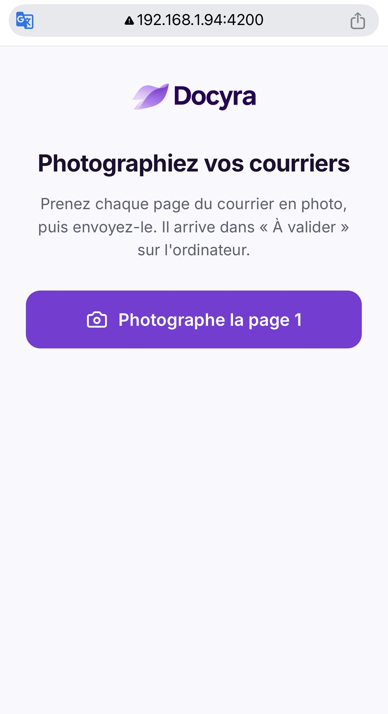

# Docyra

Outil pour secrétariat médical : la secrétaire prend les courriers en photo avec son téléphone, Docyra trouve le patient dans le texte et crée le PDF `NOM_Prénom.pdf`, prêt à classer dans le dossier du patient.




## Fonctionnalités

- Import de la liste des patients depuis un fichier CSV
- Lecture du texte du courrier (OCR avec Tesseract)
- Recherche du patient dans le texte, sans tenir compte des accents ni des majuscules
- Détection et redressement de la page sur la photo (OpenCV)
- Création du PDF avec le nom du patient (Apache PDFBox)
- File « À valider » et page de vérification du patient
- Connexion sécurisée (Spring Security, JWT)
- Scan par téléphone : un QR code sur l'ordinateur ouvre la page de scan, sans application à installer
- Courriers de plusieurs pages : toutes les pages sont lues et réunies dans un seul PDF
- Effet scanner : papier blanc et texte noir, même avec une lumière faible ou jaune
- Ajout d'un patient directement depuis la page de vérification
- Téléchargement de tous les courriers validés dans un seul ZIP

| Patients | À valider |
| --- | --- |
|  |  |

| Connexion | QR code | Scan sur téléphone |
| --- | --- | --- |
|  |  |  |

## Stack

- **Back** : Java 25, Spring Boot, Spring Security (JWT), Spring Data JPA, PostgreSQL, Flyway, Tess4J, OpenCV, PDFBox
- **Front** : Angular, Lucide
- **Outils** : Docker Compose, JUnit, Mockito

## Lancer le projet

```bash
cp .env.example .env
docker compose up --build
```

- Application : http://localhost:8000
- API : http://localhost:8080

Compte par défaut : celui défini par `DOCYRA_ACCOUNT_EMAIL` et `DOCYRA_ACCOUNT_PASSWORD` dans `.env`.

## Variables d'environnement

| Variable | Rôle |
| --- | --- |
| `POSTGRES_DB`, `POSTGRES_USER`, `POSTGRES_PASSWORD` | Base de données |
| `DOCYRA_ACCOUNT_EMAIL`, `DOCYRA_ACCOUNT_PASSWORD` | Compte créé au premier démarrage |
| `DOCYRA_JWT_SECRET` | Clé de signature des jetons (32 caractères minimum) |
| `DOCYRA_SCAN_BASE_URL` | Adresse utilisée dans le QR code |

## Tester le scan sur un téléphone

1. Le téléphone et l'ordinateur doivent être sur le même Wi-Fi.
2. Récupérez l'adresse IP de l'ordinateur :
   ```bash
   ipconfig getifaddr en0
   ```
3. Dans `.env`, mettez cette adresse dans `DOCYRA_SCAN_BASE_URL`, par exemple `http://192.168.1.20:8000`. Changez-la à chaque nouveau réseau.
4. Relancez `docker compose up`.
5. Sur l'ordinateur, connectez-vous et ouvrez la page **Téléphone**.
6. Scannez le QR code avec le téléphone, prenez les pages en photo, puis envoyez le courrier.
7. Le courrier arrive dans **À valider** sur l'ordinateur.


## Données

Le projet ne contient que des patients et des courriers inventés. Docyra tourne en local : aucun courrier ne quitte l'ordinateur.
